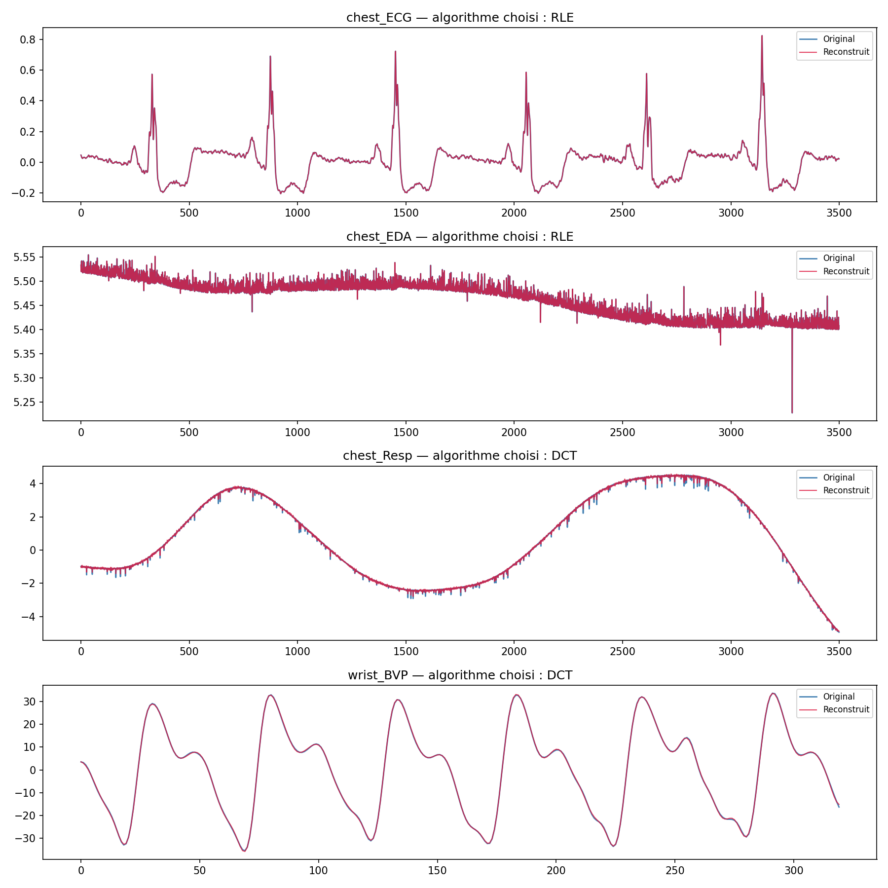
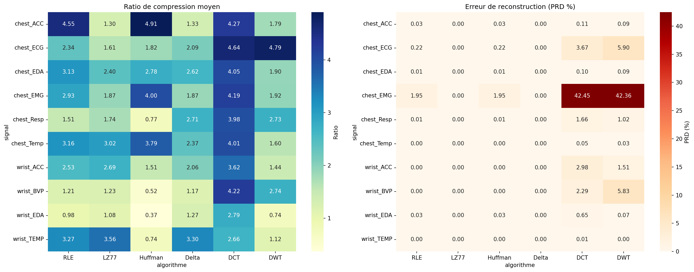
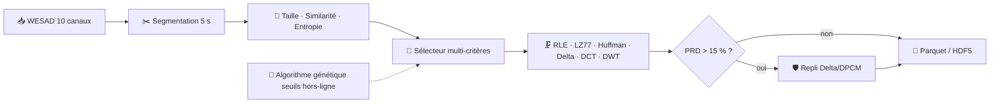
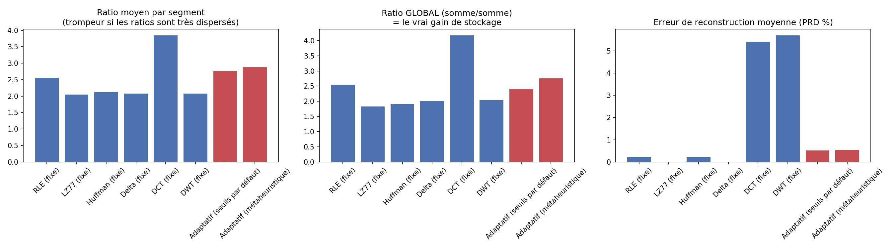
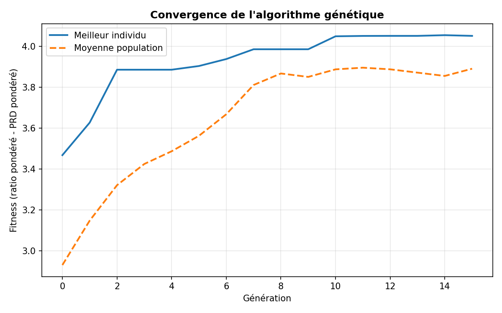
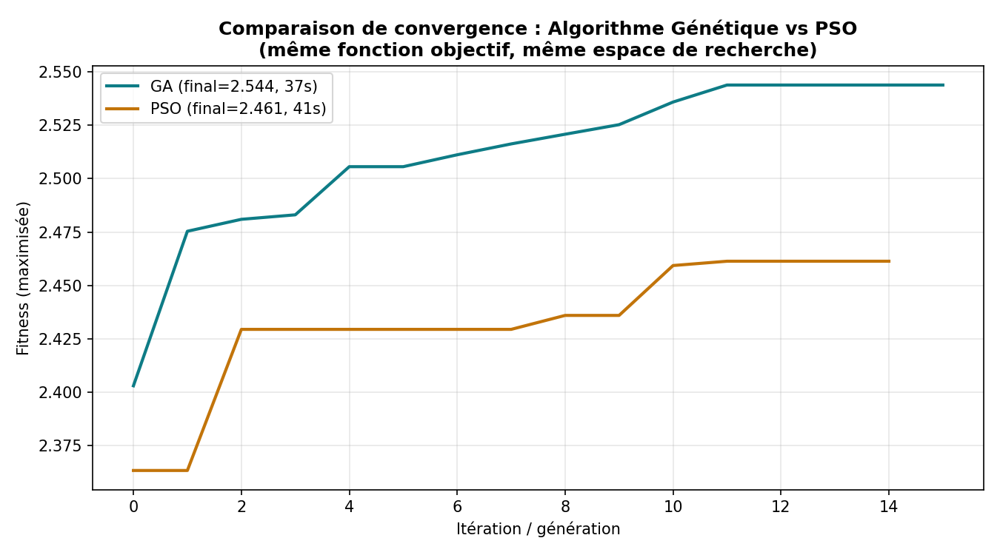
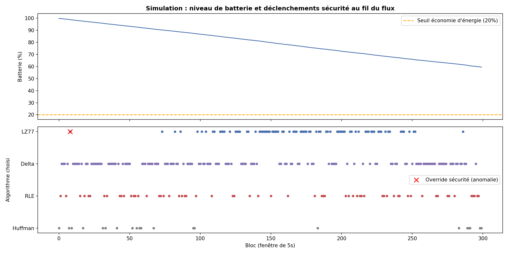
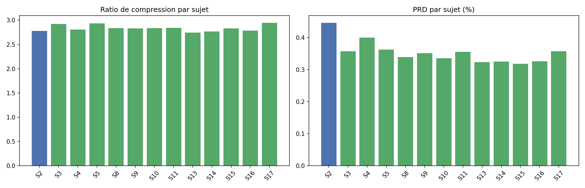
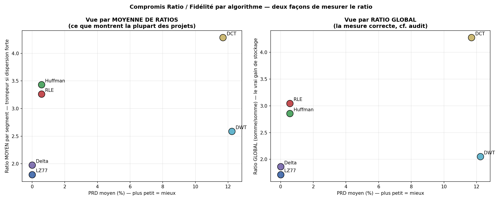

<div align="center">

# 🗜️ Compression Adaptative de Signaux Physiologiques Multi-Capteurs

### Sélection dynamique d'algorithme par métaheuristique (algorithme génétique)

*Wearables · Signal Processing · Optimisation · Big Data (Parquet / HDF5) · Python*

<br>


-%3C0.55%25-2ea44f?style=flat-square)


<br>

[📄 Rapport (32 p.)](report/Rapport_Compression_Adaptative.pdf) · [📓 Notebooks](notebooks/) · [📊 Résultats](#-résultats) · [🖥️ Dashboard](docs/dashboard_projet.html) · [🚀 Lancer](#-installation-et-lancement)

</div>

---

> **🇬🇧 EN —** Adaptive compression of multi-sensor physiological signals (ECG, EDA, EMG, respiration, temperature, accelerometer, BVP). Instead of one fixed algorithm, the system **selects, segment by segment, the best of 6 algorithms** (RLE, LZ77, adaptive Huffman, Delta/DPCM, DCT, DWT) using three criteria (segment size, similarity, Shannon entropy). The five selector thresholds are optimised offline by a **genetic algorithm (DEAP)**, and a post-compression **safety net** guarantees reconstruction error stays below 15 %. Validated on 13 subjects of the WESAD dataset: **global ratio ≈ 2.4–2.6×, mean PRD 0.32–0.45 %, 61.7 % real storage saving (Parquet)**. Team project, Master Big Data, AI & Advanced Applications, Ibn Tofaïl University.

## ✨ Points clés

| | |
|---|---|
| 🎯 **Problème** | Les objets connectés de santé produisent des flux multi-capteurs (4 Hz à 700 Hz) coûteux en stockage, bande passante et batterie. Un algorithme fixe unique est sous-optimal : l'ECG, la température et l'EMG n'ont pas la même structure. |
| 💡 **Idée** | Choisir **dynamiquement l'algorithme pour chaque segment de 5 s**, selon sa taille, sa similarité avec le segment précédent et son entropie. |
| 🧬 **Optimisation** | Seuils du sélecteur appris par **algorithme génétique** (fonction objectif : ratio global, PRD pondéré par la criticité clinique, coût CPU, diversité). |
| 🛡️ **Garantie** | **Filet de sécurité** : si le PRD dépasse 15 %, bascule automatique vers Delta/DPCM (quasi sans perte). **0 dépassement** sur les 13 sujets. |
| 📦 **Gain réel** | **8,61 Mo → 3,30 Mo** en Parquet (**61,7 %**), 3,41 Mo en HDF5 (60,4 %). |

## 📸 Aperçu des résultats

<p align="center">
  
</p>

<p align="center">
  
</p>

*Aucun algorithme ne domine sur les 10 canaux : DCT donne le meilleur ratio, mais s'effondre sur l'EMG (**PRD > 42 %**).*

## 🗂️ Dataset

[**WESAD**](https://archive.ics.uci.edu/dataset/465/wesad+wearable+stress+and+affect+detection) (*Wearable Stress and Affect Detection*) : 15 sujets exploitables, protocole alternant repos, stress (TSST) et amusement.

| Caractéristique | Valeur |
|---|---|
| Dispositifs | **RespiBAN** (thorax, 700 Hz) + **Empatica E4** (poignet, 4 / 32 / 64 Hz) |
| Canaux exploités | ECG, EDA, EMG, RESP, TEMP, ACC (thorax) + BVP, EDA, TEMP, ACC (poignet) = **10 canaux** |
| Sujets exploités | **13 sur 15** (S6 et S7 exclus : fichier synchronisé absent de l'extraction) |
| Segmentation | Fenêtres de **5 secondes**, non chevauchantes |

> 📦 Le dataset n'est **pas** inclus dans ce dépôt (trop volumineux). Téléchargement direct : **[WESAD.zip (≈ 2,1 Go compressé, ≈ 15 Go décompressé)](https://uni-siegen.sciebo.de/s/HGdUkoNlW1Ub0Gx/download)**. Détails dans [Installation](#-installation-et-lancement).

## 🧠 Méthodologie



### Les 6 algorithmes (6 familles différentes)

| Famille | Algorithme | Type |
|---|---|---|
| Redondance | **RLE** | Quasi sans perte (arrondi) |
| Dictionnaire | **LZ77** | Sans perte |
| Entropique | **Huffman adaptatif** | Quasi sans perte |
| Prédictif | **Delta / DPCM** | Sans perte |
| Transformée fréquentielle | **DCT** | Avec perte |
| Ondelettes | **DWT** | Avec perte |

### Fonction objectif de l'algorithme génétique

```
Fitness = W_ratio × ratio_global  −  W_prd × PRD_pondéré  −  W_time × temps_normalisé  +  W_div × diversité
```

| Terme | Rôle |
|---|---|
| `ratio_global` | Somme des tailles brutes / somme des tailles compressées (**pas** une moyenne de ratios) |
| `PRD_pondéré` | Pénalité selon la criticité clinique : **ECG ×2,5**, BVP ×1,5 |
| `temps_normalisé` | Coût CPU par segment (budget de 10 ms), pertinent pour l'embarqué |
| `diversité` | Entropie de Shannon normalisée des choix d'algorithmes (évite la dégénérescence) |

Sélection par **tournoi** (la fitness peut être négative, ce qui exclut la roulette). Seuils appris sur **un seul sujet (S2)**, puis testés sur les autres.

## 📊 Résultats

### Benchmark : algorithmes fixes vs sélection adaptative (sujet S2)

| Méthode | Ratio global | PRD (%) | Temps / segment (ms) |
|---|---:|---:|---:|
| RLE (fixe) | 2,55 | 0,22 | 0,72 |
| LZ77 (fixe) | 1,83 | 0,00 | 0,49 |
| Huffman (fixe) | 1,90 | 0,22 | 4,14 |
| Delta (fixe) | 2,01 | 0,00 | 0,64 |
| DCT (fixe) | **4,17** | 5,40 ⚠️ | 0,32 |
| DWT (fixe) | 2,04 | 5,69 ⚠️ | 0,51 |
| Adaptatif (seuils par défaut) | 2,41 | 0,52 | 0,69 |
| 🏆 **Adaptatif (métaheuristique)** | **2,75** | **0,53** | 1,46 |

La sélection adaptative offre le meilleur compromis : un ratio proche du meilleur algorithme fixe acceptable, avec un PRD **10 fois plus faible** que DCT/DWT.

<p align="center">
  
</p>

### 🧬 Convergence de l'algorithme génétique

<p align="center">
  
  
</p>

**GA vs PSO** (même fonction objectif simplifiée, même espace de recherche) : fitness **2,544 contre 2,461**, soit +3,3 % pour le GA, à temps de calcul comparable (37 s contre 41 s).

### 🛡️ Le filet de sécurité

Sur le canal **EMG**, large bande et quasi bruité, DCT et DWT échouent : **PRD de 42,5 %**. Plutôt que de compter sur des seuils bien calibrés, le système mesure le PRD réel après compression et **bascule vers Delta/DPCM** s'il dépasse 15 %.

<p align="center">
  
</p>

### 🌍 Généralisation sur sujets jamais vus

Seuils appris sur **S2**, testés sur **12 autres sujets** :

| | Valeur |
|---|---:|
| Ratio global | 2,38 – 2,58× |
| PRD moyen | 0,32 – 0,45 % |
| Dépassements du seuil de 15 % | **0** |

<p align="center">
  
</p>

### 💾 Gain de stockage réel

Échantillon de 1 000 segments (100 par capteur, 10 capteurs) :

| Format | Taille | Gain |
|---|---:|---:|
| Données brutes | 8,61 Mo | : |
| Octets compressés (théorique) | 3,26 Mo | 62,1 % |
| **Parquet** | **3,30 Mo** | **61,7 %** |
| HDF5 | 3,41 Mo | 60,4 % |

### 🔬 Un biais méthodologique identifié et corrigé

Le **ratio moyen** (moyenne de ratios par segment) surestime le gain : quelques segments à ratio extrême le tirent vers le haut. Le projet rapporte systématiquement le **ratio global** et optimise directement celui-ci. Après correction, le gain de stockage mesuré est de **61,7 %**, contre **0,3 %** avec la version non corrigée.

<p align="center">
  
</p>

## ⚠️ Limites et résultats honnêtes

Ce projet documente aussi ce qui n'a **pas** marché parfaitement :

| Constat | Détail |
|---|---|
| 🧪 **Utilité en aval instable** | Classification du stress (Random Forest, CV par blocs à 5 replis) : accuracy **0,932** sur signal brut, **0,745** sur signal reconstruit (F1 : 0,928 contre 0,409). Un PRD faible ne garantit donc pas la préservation de l'utilité diagnostique. Les replis 1 et 2 tombent à un F1 de 0,000. |
| 📉 **Petits segments** | Sous une taille critique, les algorithmes à surcoût fixe deviennent contre-productifs : Huffman atteint un ratio de **0,29** sur 14 échantillons. C'est ce qui justifie le critère *taille* du sélecteur. |
| 🧑‍⚕️ **Pas de validation clinique** | La détection d'anomalies par erreur de reconstruction (annexe) signale plutôt des problèmes de qualité du signal que des anomalies cardiaques. |
| 📏 **Échelle** | 13 sujets, un seul dataset (WESAD). Le gain de stockage est mesuré sur 1 000 segments, pas sur l'ensemble. |

**Pistes** : intégrer une métrique d'utilité en aval dans la fonction objectif, filet de sécurité par intervalle de confiance appris par canal, évaluation du stockage sur les 13 sujets.

## 🚀 Installation et lancement

```bash
# 1. Cloner
git clone https://github.com/Bilal-Jellaoui/adaptive-physiological-signal-compression.git
cd adaptive-physiological-signal-compression

# 2. Environnement virtuel
python -m venv venv
venv\Scripts\activate            # Windows
# source venv/bin/activate       # Linux / macOS

# 3. Dépendances
pip install -r requirements.txt
```

**Données** : le dataset WESAD est hébergé par l'Université de Siegen (voir aussi la [page UCI](https://archive.ics.uci.edu/dataset/465/wesad+wearable+stress+and+affect+detection)).

| | Taille |
|---|---:|
| Archive compressée | **≈ 2,1 Go** |
| Décompressé | **≈ 15 Go** (prévoir l'espace disque) |

```python
WESAD_URL = "https://uni-siegen.sciebo.de/s/HGdUkoNlW1Ub0Gx/download"
```

Télécharger puis décompresser l'archive, et placer les sujets ainsi : `WESAD/S2/S2.pkl`, `WESAD/S3/S3.pkl`, etc. Seuls 13 sujets sont utilisés (S6 et S7 exclus).

**Notebooks** : conçus pour **Google Colab** avec Google Drive. Chaque notebook définit un chemin racine :

```python
BASE = '/content/drive/MyDrive/Projet_Compression_WESAD'   # à adapter à votre machine
```

Pour une exécution locale, remplacer `BASE` par un dossier de votre PC, et supprimer les lignes `drive.mount(...)`. Exécuter les notebooks **dans l'ordre** : chacun consomme les fichiers produits par les précédents (seuils, métriques).

| Notebook | Rôle |
|---|---|
| `01_Exploration_Signaux` | Chargement WESAD, statistiques, hétérogénéité des 10 canaux |
| `02_Algorithmes_Compression` | Implémentation et benchmark des 6 algorithmes |
| `03_Metaheuristique` | Sélecteur multi-critères, optimisation par GA |
| `04_Validation_Generalisation` | Sujets non vus, validation croisée, classification en aval |
| `05_Demo_Live` | Démonstration en flux, bloc par bloc |
| `06_Stockage_Visualisations` | Export Parquet / HDF5, visualisations |
| `07_Comparaison_GA_PSO` | Comparaison GA vs PSO |

## 📁 Structure du dépôt

```
adaptive-physiological-signal-compression/
├── README.md
├── requirements.txt
├── notebooks/                      # 7 notebooks Jupyter / Colab
├── results/
│   ├── figures/                    # 18 figures
│   ├── best_thresholds.json        # Seuils optimaux appris par le GA
│   └── *.csv                       # Métriques détaillées
├── data_compressed/                # Sorties Parquet et HDF5
├── docs/
│   └── dashboard_projet.html       # Dashboard de synthèse
└── report/
    └── Rapport_Compression_Adaptative.pdf
```

## 🛠️ Compétences mises en œuvre


-2ea44f?style=flat-square)


## 👥 Équipe

**Bilal Jellaoui** · [GitHub](https://github.com/Bilal-Jellaoui) · [LinkedIn](https://www.linkedin.com/in/TON-PROFIL)
**Mohamed Azil** · **Ayoube Echihami**

Master Big Data, IA & Applications Avancées : Université Ibn Tofaïl, Faculté des Sciences de Kénitra · 2025–2026
Encadrant : Pr. Ayoub Sghir

🎯 *À la recherche d'un stage de PFE en 2027 : Data Science & Analytics · Machine Learning · Python · SQL · Big Data.*
